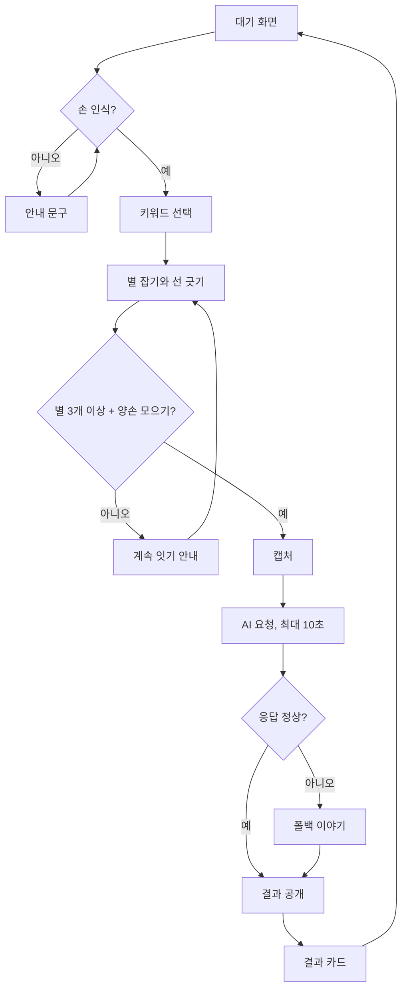

# 별자리 VR 콘텐츠 기획서

작성일 2026-11-11 · 강민우

## 개요

핸드트래킹으로 밤하늘의 별을 이어 나만의 별자리를 그리면, AI가 그 모양을 보고 이름과 짧은 이야기를 지어주는 퀘스트3 VR 체험이다.

| 항목 | 내용 |
| --- | --- |
| 작품명 | Constellation - One star, One story |
| 참여 분야 | VR 콘텐츠 |
| 플랫폼 | Meta Quest 3, 컨트롤러 없이 핸드트래킹 |
| 엔진 | Unity (XR Hands) |
| 체험 시간 | 1인 3~5분 |
| 전시 | 남서울대학교 제12회 VR·AR 콘텐츠 전시회, 2026.12.3(목)~12.11(금), 시상 12.4 |
| 브로셔 이미지 마감 | 2026.11.22 (3840×2160, 작품개요 100자 이내) |
| 제출자 | 경영학과 |
| 제출 방법 | 3darvr@gmail.com 메일 + 구글 폼 |

## 기획 의도와 차별점

별자리를 그리는 핸드트래킹 VR 앱은 이미 있어서, 이 작품의 차별점은 AI가 내가 그린 모양을 읽고 한국어 이야기를 지어주는 데 있다.

| 기존 사례 | 하는 일 |
| --- | --- |
| [Stroodle](https://queststoredb.com/app/stroodle-23919713550958900) | 퀘스트 핸드트래킹과 패스스루로 별을 이어 상상을 그린다 (2025.6 얼리액세스) |
| [Connectome](https://www.uploadvr.com/connectome-vr-impressions/) | 핸드트래킹으로 공간의 점들을 선으로 이어 도형을 만든다 |
| [Constellations: Touch the Stars](https://uploadvr.com/constellations-touch-the-stars-early-access-release) | 별자리 감상 중심, 나만의 별자리 만들기는 예고된 기능 |

2026.11.11 검색 범위에서는 그린 모양을 AI가 해석해 이야기로 돌려주는 사례를 찾지 못했다. 전수 조사는 아니다.

- 만든 것이 이름, 이야기, 별자리 이미지를 담은 결과 카드로 돌아와 기념이 된다.
- 이야기는 한국 설화 풍의 한국어로 나온다.
- 체험을 짧고 반복 가능하게 만들어 천문대·과학관 전시로 확장할 수 있다.

## 체험 플로우

한 사람의 체험은 대기 화면에서 결과 카드까지 9단계, 총 3~5분으로 끝난다.

1. **대기 화면**: 밤하늘과 안내 문구가 나오고, 손을 들면 핸드트래킹이 인식되며 시작한다.
2. **키워드 선택**: 어떤 별자리를 만들까요? 질문에 아이콘 3개(소원·모험·소중한 사람) 중 하나를 손으로 집는다.
3. **별 잡기**: 하늘에 떠 있는 별을 핀치로 집어 차례로 이어 별자리를 그린다.
4. **완성**: 정해진 제스처(양손 모으기)로 그리기를 마친다.
5. **캡처**: 그린 별자리를 2D 이미지로 저장한다.
6. **AI 해석**: 이미지와 키워드를 보내고, 응답을 기다리는 5~10초 동안 별빛이 모이는 연출을 보여준다.
7. **결과 공개**: 별자리 이름과 짧은 이야기를 하늘에 글자로 띄운다.
8. **결과 카드**: 이름, 이야기, 별자리 이미지를 한 장으로 묶어 저장한다. 전시장에서는 QR이나 출력으로 제공한다.
9. **종료**: 자동으로 대기 화면에 돌아가 다음 체험자를 받는다.

AI 응답이 실패하면 6단계에서 미리 만든 이야기로 넘어간다.



판단은 손 인식, 완성 확인, AI 응답 세 곳이고, 실패하면 안내나 폴백을 거쳐 결과 공개 단계까지 항상 이어진다.

## 핵심 기능

핵심 입력은 핀치 하나이고, 손 추적 오차를 줄이려고 별은 자유 배치가 아니라 하늘에 미리 떠 있는 후보 중에서 고른다.

| 기능 | 방식 | 비고 |
| --- | --- | --- |
| 손 입력 | Quest 3 핸드트래킹, 컨트롤러 미사용 | XR Hands 패키지 |
| 별 후보 | 하늘에 후보 약 30개를 흩뿌리고 그중에서 선택 | 제안값, 테스트 후 조정 |
| 별 잇기 | 엄지·검지 핀치로 별을 잡고 다음 별로 이동해 선을 그음 | 별 3~8개, 제안값 |
| 되돌리기 | 마지막 선 취소 제스처 1개 | 손바닥 쓸기 등, 테스트 후 결정 |
| 완성 | 양손 모으기 제스처 | 화면에 안내 표시 |
| 키워드 선택 | 손으로 집는 구체 아이콘 3개 | 소원을 비는·모험을 떠나는·소중한 사람을 위한 별자리 |
| 결과 화면 | 별자리 이름(큰 글씨) + 이야기 3문장 이내 + 카드 미리보기 | 읽기 쉬운 글자 크기 필수 |

## AI 연동 설계

체험 1회당 AI 호출은 1번이고, 그린 별자리 이미지와 키워드를 보내 이름과 이야기를 받는다.

- **입력**: 별자리 2D 캡처(축소해서 전송), 키워드 1개, 별 개수
- **키워드 값**: 소원을 비는 별자리, 모험을 떠나는 별자리, 소중한 사람을 위한 별자리. 이 문구가 프롬프트의 `{keyword}` 자리에 들어간다.
- **출력**: JSON 한 개, 이름 2~8자 + 이야기 한국어 2~3문장(120자 안팎)
- **호출 구조**: Quest 앱 → Cloudflare Workers 중계 서버 → Claude API(Haiku 5.5). API 키는 서버에만 둔다. 앱 안에 넣으면 꺼내 가기 쉽다.
- **중계 서버 역할**: 앱이 작은 JPEG와 키워드를 보내면 서버가 API 키를 붙여 요청하고 결과 JSON만 돌려준다. 허용된 키워드 3개만 받고, 이미지 크기와 1인당 호출 횟수를 제한한다. Cloudflare Workers 무료 플랜은 하루 10만 요청, 호출당 CPU 시간 10ms 제한이 있어 이미지를 작게 보내야 한다.
- **폴백**: 10초 안에 응답이 없거나 형식이 깨지면, 키워드별로 미리 만든 이름·이야기 세트에서 무작위로 나온다. 키워드 3개 × 5세트 = 15세트를 준비한다.
- **비용 관리**: 소형 모델, 이미지 축소, 출력 길이 제한, 월 사용 한도 설정, 1인 호출 횟수 제한. Haiku 5.5 단가는 입력 100만 토큰당 $0.10, 출력 $0.50(2026년 10월 기준)이다. 샘플 별자리로 Sonnet 5.5와 이야기 품질을 비교해 최종 모델을 정한다.
- **콘텐츠 안전**: 어린이도 보는 전시라서 프롬프트에 폭력·공포 표현 금지를 넣고, 길이·형식 검사를 통과하지 못하면 폴백으로 넘긴다.

프롬프트 초안:

```text
당신은 별자리에 이름을 붙이는 옛이야기꾼입니다. 첨부한 그림은 체험자가 밤하늘에서 별을 이어 만든 별자리입니다. 키워드는 '{keyword}'입니다.
1) 그림이 무엇을 닮았는지 한 가지로 정해 별자리 이름을 짓습니다(한국어 2~8자).
2) 키워드를 녹여 한국 옛이야기 분위기의 짧은 이야기를 씁니다(한국어 2~3문장, 총 120자 안팎).
어린이도 보는 전시이므로 무섭거나 폭력적인 표현은 쓰지 않습니다.
아래 JSON 형식으로만 답합니다: {"name":"","story":""}
```

## 폴백 이야기 15세트

AI 응답이 실패하면 선택한 키워드의 5세트 중 하나가 무작위로 나온다. 이름은 2~8자, 이야기는 120자 안팎이고 어린이도 볼 수 있는 내용이다.

| 키워드 | 이름 | 이야기 |
| --- | --- | --- |
| 소원을 비는 | 소원나무별 | 깊은 산골 아이가 별 하나에 소원을 빌었어요. 그 마음이 하늘에 닿아, 밤마다 소원나무별이 반짝이며 마을을 지켜 주었대요. |
| 소원을 비는 | 달토끼방아별 | 달토끼가 방아를 찧다 떨어뜨린 떡가루가 별이 되었어요. 이 별에 소원을 속삭이면 달토끼가 몰래 귀 기울여 준대요. |
| 소원을 비는 | 복주머니별 | 하늘은 별빛을 복주머니에 모아 두었다가, 소원을 비는 사람에게 한 줌씩 나눠 준대요. 오늘 밤은 바로 당신의 차례예요. |
| 소원을 비는 | 첫눈별 | 첫눈이 내리는 밤에 가장 먼저 반짝이는 별이에요. 이 별에 빌면 소원이 눈송이처럼 가볍게 하늘 높이 날아오른대요. |
| 소원을 비는 | 등불별 | 옛 마을 사람들은 소원을 등불에 담아 하늘로 띄웠어요. 그 등불들이 모여 이 별자리가 되었대요. |
| 모험을 떠나는 | 바람길별 | 바람을 타고 바다를 건너던 작은 배가 별이 되었어요. 길을 잃은 여행자에게 바람길별이 가야 할 쪽을 살며시 알려 준대요. |
| 모험을 떠나는 | 발자국별 | 산을 넘던 아이 곁에 호랑이가 길동무가 되어 주었어요. 둘이 함께 걸은 발자국이 하늘에 별로 남았대요. |
| 모험을 떠나는 | 징검다리별 | 도깨비가 은하수에 징검다리를 놓아 주었어요. 용기를 내어 한 발씩 건너는 사람에게만 보이는 다리래요. |
| 모험을 떠나는 | 구름돛단배별 | 구름을 돛 삼아 하늘을 항해하는 배예요. 새로운 곳으로 떠나는 이를 위해 밤마다 밝게 빛난대요. |
| 모험을 떠나는 | 나침반별 | 어디로 갈지 망설여질 때 이 별이 가장 먼저 반짝여요. 마음이 가리키는 쪽이 바로 당신의 길이래요. |
| 소중한 사람을 위한 | 오작교별 | 까치들이 은하수에 다리를 놓아 보고 싶은 사람을 만나게 해 준대요. 이 별자리는 그 다리의 한 자락이에요. |
| 소중한 사람을 위한 | 실타래별 | 눈에 보이지 않는 붉은 실이 소중한 사람들을 이어 준대요. 이 별자리는 그 실이 하늘에 비친 모습이에요. |
| 소중한 사람을 위한 | 달빛편지별 | 달빛에 마음을 적어 하늘로 띄우면 이 별이 대신 전해 준대요. 오늘 밤, 누구에게 보낼까요? |
| 소중한 사람을 위한 | 아랫목별 | 추운 겨울밤, 따뜻한 아랫목처럼 곁에 있으면 마음이 포근해지는 별이에요. 함께 있는 사람을 오래 지켜 준대요. |
| 소중한 사람을 위한 | 두손별 | 두 손을 맞잡은 모양의 별자리예요. 함께 걷는 두 사람의 밤길을 오래오래 비춰 준대요. |

## 비주얼·사운드 방향

하늘과 별 중심의 단일 장면이라 모델링 부담이 작고, 퀄리티는 조명과 후처리, 색 통일로 만든다.

- **장면**: 남보라에서 진한 남색으로 이어지는 밤하늘, 아래에 언덕 실루엣을 두어 방향감을 준다. 하늘과 별은 셰이더·파티클로 직접 만들어 에셋이 거의 필요 없다.
- **별과 선**: 크기·밝기가 다른 별, 이은 선은 부드럽게 빛나게(블룸).
- **조명·후처리**: 블룸, 비네트, 색 보정에 시간을 쓴다. 같은 에셋도 이것만으로 크게 달라 보인다.
- **사운드**: 잔잔한 앰비언트 배경음, 별을 잡을 때 맑은 종소리, 별을 이을 때 음이 조금씩 올라간다. 결과 낭독은 선택 사항이다.

## 전시 운영 조건

짧은 체험, 밝은 조명, 불안정한 네트워크를 기준으로 운영한다.

- **체험 시간**: 1회 1명, 설명은 1분 안팎으로 끝내야 한다. 화면 안내만으로 해볼 수 있게 한다.
- **장비**: Quest 3 한 대, 관람용 모니터에 화면 미러링. 대기하는 사람도 함께 볼 수 있다.
- **조명**: 핸드트래킹은 밝은 곳에서 잘 되므로, 전시장 조명 밝기를 사전에 확인한다.
- **네트워크**: 전시장 와이파이가 불안정하면 휴대폰 핫스팟을 예비로 두고, 그래도 안 되면 폴백 이야기로 진행한다.
- **위생**: 일회용 페이스 커버와 헤드셋 닦이용 물티슈를 배치한다.
- **결과 카드 제공**: QR 또는 출력. 출력은 프린터 지원 여부를 전시 주최 측에 확인해야 한다.

## 브로셔 제출물

제출하는 것은 이미지 1장(16:9, 3840×2160)과 작품개요(100자 이내), 제출자 학과명이다.

- **구도**: 밤하늘 한가운데 빛나는 별자리 선, 한쪽에 핀치하는 손, 아래에 언덕 실루엣. UI는 뺀다.
- **캡처 방법**: Unity에서 Game 뷰 해상도를 3840×2160으로 지정하거나 Unity Recorder로 캡처한다.
- **작품개요 초안**(공백 포함 70자):

```text
핸드트래킹으로 밤하늘의 별을 이어 나만의 별자리를 그리면, AI가 모양을 읽어 이름과 옛이야기를 지어주는 퀘스트3 VR 체험.
```

## 기술 스택과 리스크

기술 스택은 Unity, XR Hands, Claude API(Cloudflare Workers 중계 서버 경유)이고, 가장 큰 리스크는 핸드트래킹 인식과 일정이다.

| 리스크 | 대응 |
| --- | --- |
| 핸드트래킹 인식 불안정 | 별 후보 선택식, 핀치 판정 여유, 인식 실패 시 화면 안내 |
| 전시장 조명이 어두움 | 사전 확인, 필요하면 조명 요청 |
| AI 지연·실패 | 10초 타임아웃, 폴백 세트 15개 |
| 인터넷 불안정 | 휴대폰 핫스팟 예비, 폴백 |
| 부적절한 이야기 | 프롬프트 금지, 형식·길이 검사, 폴백 |
| API 비용 초과 | 월 한도, 1인 호출 제한 |
| 일정 초과 | 필수(그리기·AI·결과)와 선택(낭독, 출력, 사운드 다양화)을 나눠 필수만 먼저 완성 |

## 확장 계획

이번 전시는 1단계이고, 천문대·과학관에는 2단계 이후를 덧붙여 제안한다. 2단계 이후는 아직 제안 단계다.

1. **1단계 (이번 전시)**: 모양+키워드 기반 AI 이야기, 결과 카드
2. **2단계**: 실제 별 위치 데이터로 하늘을 구성하고, 내 별자리 옆에 실제 별자리를 함께 보여준다. 한국 전통 별자리 소개를 넣는다.
3. **3단계**: 영어 등 다국어 지원, 여러 사람이 만든 별자리를 한 하늘에 모으는 모두의 하늘 관람 화면
4. **4단계**: 천문대·과학관 제안용 자료(체험 영상, 운영 가이드, 운영 비용)

## 미정 사항

- [x] 작품명: Constellation - One star, One story (확정)
- [x] 제출자 학과명: 경영학과 (확정)
- [ ] 전시 참여 형태 확인 (현장 체험 부스인지 영상 전시인지, 주최 측 문의)
- [ ] 브로셔 이미지에 글자를 넣어도 되는지 확인
- [ ] Quest 3 기기 확보 방법
- [ ] Haiku 5.5와 Sonnet 5.5의 이야기 품질 비교 후 모델 확정
- [ ] Cloudflare 계정 생성, Claude API 키 발급, 월 사용 한도 설정
- [ ] 키워드 3개의 문구와 아이콘 확정
- [ ] 별 후보 약 30개, 선택 3~8개로 시작해 프로토타입 테스트 후 조정
- [ ] 결과 카드는 QR로 시작, 출력은 주최 측 프린터 지원 확인 후 결정
